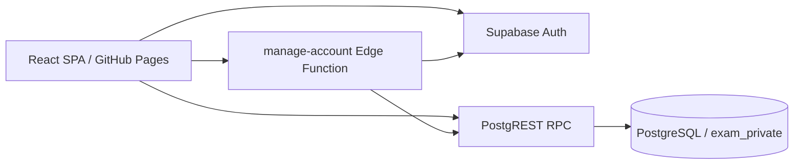
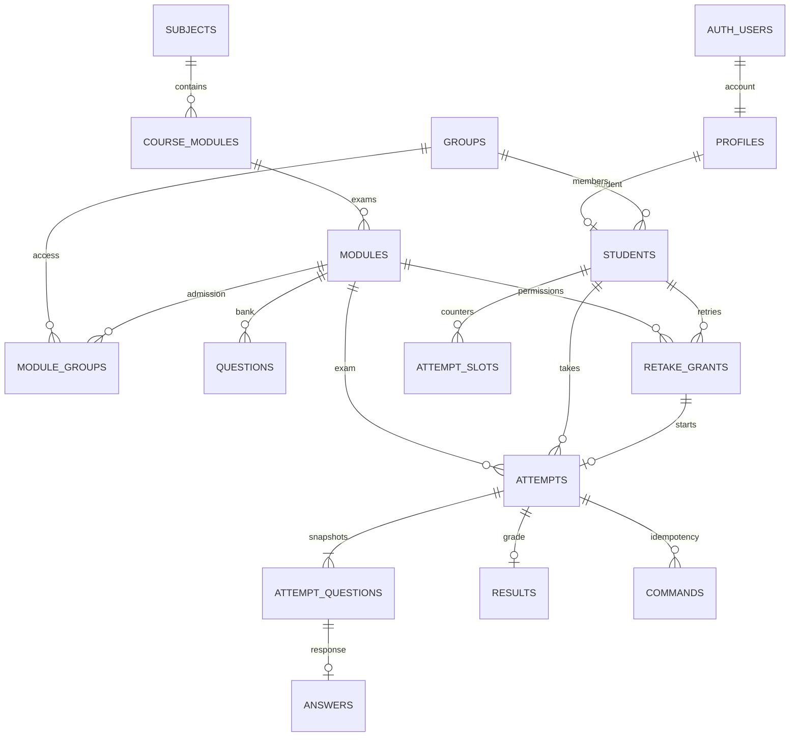

# Архитектура

## Компоненты

UI — отображение и формы. PostgreSQL — время, права, выбор вопросов, атомарный приём ответов, оценки. Auth — хеширование кодов и токены. Edge Function — проверка JWT и роли, Admin Auth API для создания аккаунтов и сброса кода. Публичный браузерный ключ не является секретом; серверный ключ в frontend отсутствует.

## Слои

`app` → `pages` → `features` → `entities` → `shared`. Неиспользуемый слой widgets пока не создаётся. Shared содержит клиент API; entities — DTO; features — импорт/экспорт; pages — пользовательские сценарии. Направление импортов проверяется тестом.

TanStack Query кеширует данные под ключами пользователя и фильтров. При смене аккаунта кеш очищается. Для команд экзамена автоматические повторы отсутствуют: явный повтор сохраняет UUID первоначальной команды. Локальные состояния не определяют оценку или дедлайн. Auth хранит сессию в localStorage; личные коды приложение отдельно не сохраняет.

## ER

Банк questions принадлежит course_modules через course_module_id; unique(course_module_id,external_id). module_id в questions — необязательная историческая ссылка на исходный экзамен (ON DELETE SET NULL), не владелец банка. Копирование экзамена копирует настройки и доступ групп, сохраняя ссылку на общий банк. При переносе одинаковые копии объединяются, различающиеся версии с совпадающим QuestionID получают уникальный суффикс. При старте текст, версия, варианты и правильный UUID сохраняются в неизменяемом attempt_questions. Редактирование или удаление вопроса не меняет начатую попытку. Запись банка блокирует строку учебного модуля FOR UPDATE, выбор вопросов при старте и валидация берут FOR SHARE.

## Конкурентность и время

Схема каталога: `subjects` → `course_modules` → `modules` (экзамены/партии). Банк принадлежит учебному модулю и используется его экзаменами. Миграция сохраняет прежние ID, вопросы, попытки и результаты; существующие экзамены относятся к Web-разработка → Модуль 1. Копирование по умолчанию сохраняет учебный модуль. Смена учебного модуля экзамена разрешена только в черновике. Каталог закрыт прямому доступу, изменения проверяют роль teacher и записываются в аудит.

Старт берёт shared lock модуля, затем row lock студента. Поэтому два старта одного аккаунта сериализуются, а разные студенты запускаются параллельно. Частичный уникальный индекс (module_id, student_id) WHERE is_current гарантирует одну действующую попытку; история хранится с возрастающим attempt_number. Номер и число запусков сохраняются в attempt_slots даже после удаления попытки.

Ответ и чтение текущего состояния сначала берут shared lock модуля, затем row lock попытки. Административная пересдача/удаление блокирует модуль, студента и попытку в том же порядке. Это устраняет цикл с FK KEY SHARE при конкурентном ответе; отдельный многосессионный тест воспроизводит оба порядка. Дедлайн проверяется через clock_timestamp(). Транзакция атомарно пишет ответ, продвигает индекс и фиксирует результат. UNIQUE(attempt_id,position) и UNIQUE(attempt_id,key) защищают ответы и команды.

Reconcile пропускает все истёкшие интервалы и завершает попытку при достижении общего дедлайна. Он вызывается при current/start/answer и из панели преподавателя. Запуск cron не обязателен для корректности; без запросов expired попытка может оставаться записанной как active до следующей сверки. Никакие оценки не публикуются до такой сверки.

Publish получает exclusive lock модуля, блокируя новые старты, сверяет активные попытки и отклоняется, если остались незавершённые. Close admission сохраняет дедлайны текущих попыток. Административные изменения одного модуля также сериализуются.

## Выбор вопросов

random: случайная выборка N уникальных активных вопросов без возвращения из всего банка. quotas: выборки без возвращения внутри каждой темы; сумма квот равна N. Общий порядок и варианты независимо перемешиваются для каждой попытки. При недостатке темы открытие блокируется; перераспределения нет. SQL random() служит для распределения экзамена, не для генерации секретов. Личные коды создаёт Web Crypto в Edge Function.

## Границы безопасности

Схема exam_private не выставлена через PostgREST. RLS включён на каждой таблице; браузерным ролям не предоставлены права схемы/таблиц. SECURITY DEFINER имеет пустой search_path и квалифицированные имена объектов; EXECUTE разрешён только на выбранные RPC. Каждая пользовательская RPC проверяет активный профиль и владение/роль. Студент не получает весь банк, ключи или закрытый результат. Административные RPC доступны роли authenticated, но проверяют teacher внутри SQL. Service-only функции недоступны authenticated/anon.

Frontend React экранирует текст вопросов и HTML-примеры. CSV-export защищает ведущие формульные символы. CORS Edge Function разрешает один origin. Supabase Auth обслуживает rate limits входа; SQL ограничивает частоту current/answer/start/admin, Edge аккаунтные операции дополнительно используют серверный лимит. Это не заменяет DDoS-защиту платформы.

## Ограничения текущей поставки

Аннулирование отделено от завершения: is_current=false, voided_at/by/reason и voided_from_status сохраняют причину и исходное состояние. Для совместимости движка аннулированная попытка становится терминальной status=finished; API показывает status=annulled и не отдаёт её оценку студенту. Dashboard считает только is_current. Разрешения одноразовые, имеют срок начала, автора, причину, consumed/revoked и сохраняются после удаления использовавшей их попытки. Результаты имеют индивидуальный published_at; первая общая публикация выставляет его действующим результатам, последующие пересдачи публикуются суперадмином отдельно. Удаление не стирает служебный счётчик и журнал. Оно удаляет данные выбранной попытки, а не весь аккаунт студента.

Нагрузочные цифры не измерены на Supabase. Embedded SQL-тесты не заменяют многосессионный PostgreSQL. Браузерный E2E использует mock API. Нет автоматического переноса исторических попыток/результатов. Студенты блокируются вместо удаления аккаунтов, чтобы сохранять историю; удаление отдельной попытки доступно суперадмину с аудитом. Экспорт результатов — CSV и XLSX. Импорт групп и аккаунтов последовательный, с возможностью частичного выполнения; банк импортируется одной транзакцией. Отдельный endpoint `/api/v1` заменён стандартными `/rest/v1/rpc` и `/functions/v1` Supabase.
